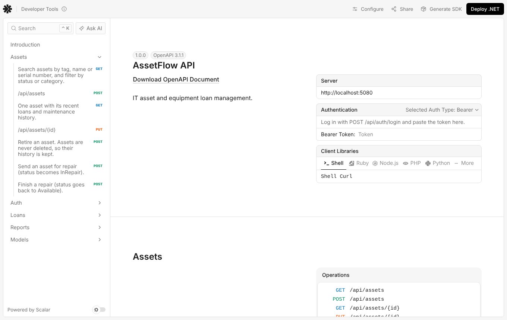
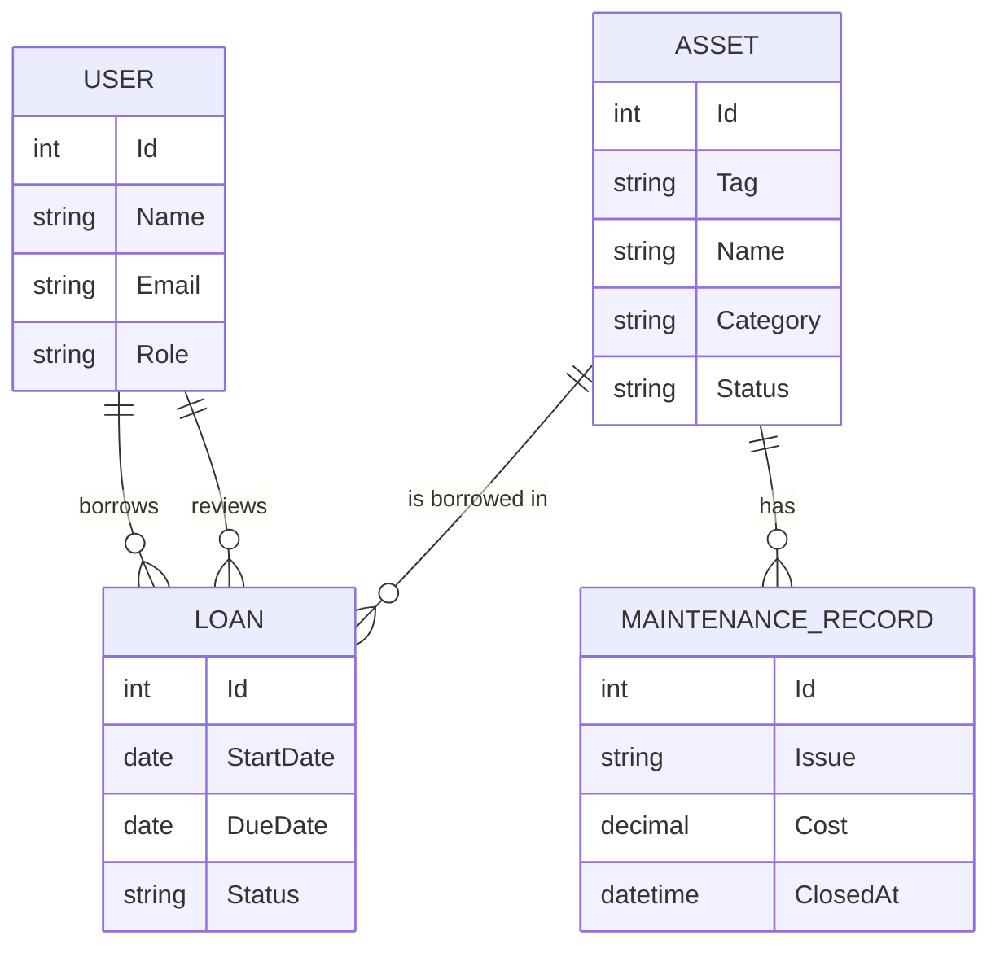

# AssetFlow

An **IT asset and equipment loan system**, the kind of internal tool companies use to track laptops, monitors and other equipment, and who has borrowed what.

Staff request equipment, admins approve and hand it out, and the system tracks returns, repairs and overdue loans.



## Features

- **Assets**: create, search, filter by status and category, update, retire (never deleted, so history is kept)
- **Loan workflow**: `Requested → Approved → CheckedOut → Returned`, with reject and cancel
- **Business rules** enforced in the domain model:
  - no double booking of the same asset for overlapping dates
  - maximum loan of 30 days; no start dates in the past
  - assets in repair or retired cannot be borrowed
  - an asset on loan cannot be sent for repair or retired
- **Repairs**: send an asset for repair, then close it with a resolution and cost
- **Overdue tracking** and an admin **summary report** (assets by status, pending and overdue loans, most borrowed, repair costs)
- **Authentication** with JWT and two roles: `Staff` and `Admin`
- **Interactive API docs** (OpenAPI + Scalar) at `/scalar`

## Tech stack

| Area | Technology |
|---|---|
| API | **C# / ASP.NET Core 10** Web API (controllers) |
| Database | **PostgreSQL** with **Entity Framework Core** (code-first migrations) + raw SQL for reports |
| Auth | JWT bearer tokens, role-based authorisation, hashed passwords |
| Docs | OpenAPI 3.1 + Scalar UI |
| Tests | **xUnit**: domain unit tests + API integration tests (`WebApplicationFactory`, SQLite, fake clock) |
| CI | **GitHub Actions**: build and test on every push |

## Architecture

```
Controllers  →  Services (interfaces)  →  Domain model  →  EF Core  →  PostgreSQL
 HTTP / JSON     application logic        business rules     data access
```

- **Domain** (`Domain/`): `Asset`, `Loan`, `User` and `MaintenanceRecord` are classes that protect their own rules. Properties have private setters; status only changes through methods like `loan.Approve()` or `asset.SendToRepair()`, which refuse invalid steps.
- **Services** (`Services/`): each has an interface (`ILoanService` and so on) and is registered with **dependency injection**, so it's easy to test and swap.
- **Errors**: business errors become clean HTTP responses (`400`, `404`, `409`) as RFC 7807 problem details.



## Run it locally

Requires the [.NET 10 SDK](https://dotnet.microsoft.com/download) and [PostgreSQL](https://www.postgresql.org/download/).

```bash
cd src/AssetFlow.Api

# Store your database connection privately (never committed to Git)
dotnet user-secrets set "ConnectionStrings:Default" "Host=localhost;Port=5432;Database=assetflow;Username=postgres;Password=YOUR_PASSWORD"

dotnet run
```

The database and demo data are created automatically on first run. Open **http://localhost:5080/scalar**.

**Demo accounts**

| Role | Email | Password |
|---|---|---|
| Admin | admin@assetflow.dev | Admin@12345 |
| Staff | staff@assetflow.dev | Staff@12345 |

In Scalar: call `POST /api/auth/login`, copy the `token`, and paste it into **Authentication → Bearer Token**.

## Tests

```bash
dotnet test
```

27 tests: business rules (loan lifecycle, 30-day limit, repairs, overdue) and full HTTP flows (login, permissions, double booking, overdue report). The API tests run against SQLite with a fake clock, so no database server is needed.

## Roadmap

- [x] REST API, PostgreSQL, JWT roles, tests, CI
- [ ] React + TypeScript frontend
- [ ] Deploy to **Azure** (App Service + Azure Database for PostgreSQL)
- [ ] AI assistant: answer questions about loan policies with **RAG**
- [ ] Mobile app to check items in and out by scanning a QR code